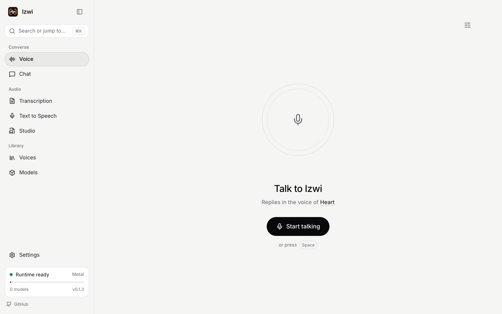

<p align="center">
  
</p>

<h1 align="center">Izwi</h1>

<p align="center"><strong>Open-source voice AI that runs on your machine.</strong></p>

<p align="center">
  <a href="https://izwiai.com">Website</a> -
  <a href="https://izwiai.com/docs">Documentation</a> -
  <a href="https://github.com/izwi-ai/izwi/releases">Releases</a> -
  <a href="https://github.com/izwi-ai/izwi/issues">Issues</a>
</p>

<p align="center">
  
</p>

Izwi runs speech recognition, text-to-speech, voice chat, and chat models on
your own machine. Use it as a desktop app, a web UI, or a CLI, or point your
own apps and phone lines at its OpenAI-compatible server. Models download once
from Hugging Face; after that, inference runs entirely on your machine, with no
cloud service or API key.

## What It Does

### In the app

- **Voice:** talk with a local assistant. The Standard engine chains speech
  recognition, chat, and TTS models; the Compact engine uses one
  speech-to-speech model (LFM3 Audio). Give it tools from MCP servers, let
  agents hand the conversation to each other, and turn on memory so it keeps
  your preferences.
- **Dictation** (desktop app): hold `⌥ Space` on macOS or `Ctrl+Shift+Space`
  on Windows and Linux in any app, speak, and Izwi types what you said at the
  cursor.
- **Transcription:** files or live audio, with speaker diarization,
  speaker-attributed transcripts, word timestamps, summaries, and translation
  on models that support it.
- **Text to Speech and Studio:** built-in voices, voice cloning from a short
  sample, voice design from a description, and long-form projects edited
  segment by segment.
- **Chat, Voices, and Models:** local chat, saved voices, and model download,
  load, and unload, with each model's real memory need shown before you
  download it.

### For developers

The server speaks OpenAI's APIs at `http://localhost:8080/v1`, so the stock
OpenAI SDKs work once you change the base URL.

- Chat Completions with tool calling (forced and strict tool calls), and a
  preview of the Responses API.
- Speech (WAV, MP3, Opus, FLAC, or PCM, whole or streamed), transcriptions,
  translations, and cloned voices (`/v1/audio/voices`).
- Realtime (`/v1/realtime`): speech-to-speech sessions with unmodified OpenAI
  Realtime clients, including LiveKit Agents and Pipecat, with function and
  MCP tools.
- Phone calls: live transcription and voice agents over a carrier's media
  stream (`/v1/realtime/media-stream`).
- Files and Batch (`/v1/files`, `/v1/batches`) for bulk transcription and
  speech. Batch work yields to live calls and streams on the same server.
- An interactive API reference at `/docs` and the OpenAPI document at
  `/openapi.json`.

### For self-hosting

- Docker Compose for CPU and NVIDIA CUDA, with a production overlay: API key
  required, read-only root filesystem, and optional TLS through Caddy.
- An API key (`IZWI_API_KEY`) is required whenever the server listens beyond
  localhost.
- Many concurrent users per model on CUDA, with admission control and service
  tiers so bulk work yields to live calls.
- `izwi-gateway`: one authenticated OpenAI-compatible endpoint, with its own
  API keys and per-tenant quotas, in front of several Izwi servers.
- Prometheus metrics (`/v1/metrics/prometheus`), `/livez` and `/readyz`
  probes, JSON logs, and PostgreSQL storage (`IZWI_DATABASE_URL`) in place of
  the default SQLite.

Optional anonymous desktop analytics are off unless you opt in. They never
send prompts, transcripts, audio, local paths, or personal identifiers.

## Install

### Desktop app

Download the latest build from
[GitHub Releases](https://github.com/izwi-ai/izwi/releases):

| Platform | File |
| --- | --- |
| macOS (Apple Silicon) | `Izwi_<version>_aarch64.dmg`: open it and drag `Izwi.app` to Applications |
| Windows (x64) | `Izwi_<version>_x64-setup.exe` |
| Linux (x86_64) | `Izwi_<version>_amd64.deb` (`sudo apt install ./Izwi_*_amd64.deb`) or `Izwi_<version>_amd64.AppImage` |

The builds are not code-signed yet. On macOS, if Izwi is blocked on first
launch, open **System Settings > Privacy & Security** and click **Open
Anyway**. On Windows, click **More info > Run anyway** in the SmartScreen
prompt. The app checks GitHub Releases for updates.

To use `izwi` in a terminal, open **Settings > System > Command line tool** in
the app and select **Install** (the `.deb` installs it for you).

### Terminal tools

Each release also ships the binaries as archives:
`izwi-cli-v<version>-macos.tar.gz` (Apple Silicon),
`izwi-cli-v<version>-linux-x86_64.tar.gz`, and
`izwi-cli-v<version>-windows-x86_64.zip`. Each holds `izwi`, `izwi-server`
(with the web UI built in), `izwi-gateway`, `izwi-desktop` (for
`izwi serve --mode desktop`), and the serving supervisor and worker. Unpack it
and add the folder to your `PATH`.

### Docker

```bash
git clone https://github.com/izwi-ai/izwi.git
cd izwi
docker compose up -d
```

For an NVIDIA GPU, start the CUDA service instead. It needs NVIDIA driver 580
or newer, the NVIDIA Container Toolkit, and an Ampere (compute capability 8.0)
or newer GPU:

```bash
docker compose --profile cuda up -d izwi-cuda
```

Compose builds the image on your machine. See
[Docker](https://izwiai.com/docs/installation/docker) for the production
setup.

### Hardware

- **macOS on Apple Silicon:** Metal on macOS 15 and later, CPU on older
  versions. The desktop app needs macOS 13.3 or later; the terminal tools run
  on macOS 12 or later. There is no Intel Mac build.
- **Linux and Windows:** the release builds run on the CPU.
- **NVIDIA CUDA:** the Docker CUDA image, or a source build.

See the [Runtime Support Matrix](https://izwiai.com/docs/support-matrix) for
the full contract.

## Quick Start

Start the server and open the web UI:

```bash
izwi serve --mode web
```

The server listens on `http://localhost:8080`. `izwi serve` starts it without
opening a browser, `izwi serve --mode desktop` opens the desktop app, and
`--no-ui` serves the API only.

In a second terminal, download a model and generate speech. Kokoro-82M needs
`espeak-ng` (`brew install espeak-ng` or `sudo apt install espeak-ng`; the
Docker image includes it):

```bash
izwi pull Kokoro-82M
izwi tts "Hello from Izwi." --output hello.wav
```

Transcribe it back:

```bash
izwi pull Parakeet-TDT-0.6B-v3
izwi transcribe hello.wav --model Parakeet-TDT-0.6B-v3
```

`izwi list` shows every model, and `izwi --help` lists the other commands,
among them `chat`, `diarize`, `align`, `status`, `config`, and `bench`.

The same models from Python, with the OpenAI SDK:

```python
from openai import OpenAI

client = OpenAI(base_url="http://localhost:8080/v1", api_key="not-needed")

speech = client.audio.speech.create(
    model="Kokoro-82M", voice="af_heart", input="Hello from Izwi.", response_format="wav"
)
speech.write_to_file("hello.wav")

with open("hello.wav", "rb") as audio:
    transcript = client.audio.transcriptions.create(model="Parakeet-TDT-0.6B-v3", file=audio)
print(transcript.text)
```

## Models

Run `izwi list`, or open **Models** in the app, to see the catalog and each
model's memory need. The catalog includes:

| Task | Models |
| --- | --- |
| Text to speech | Kokoro 82M, Qwen3-TTS (0.6B and 1.7B Base and CustomVoice, 1.7B VoiceDesign), Chatterbox and Chatterbox Multilingual, Maya1, Maya 2 Native, Ming 3.0 TTS 0.5B, VibeVoice 1.5B, Voxtral 4B TTS, Fish Audio S2 Pro, Fish Audio Drama 3, Audio8 TTS Realistic Air |
| Speech recognition | Parakeet TDT 0.6B v3, Whisper Large v3 Turbo, Qwen3-ASR (0.6B, 1.7B), Rumble 2 Flash, Nemotron 3.5 ASR Streaming 0.6B, Voxtral Mini 4B Realtime, Granite Speech 4.1 2B and 4.1 2B Plus (speaker-attributed), Granite Speech 5.0 2B (translation, keyword biasing), Nemotron 3.5 Transcribe 30B-A4B (translation, keywords, speaker labels, word timestamps), VibeVoice ASR |
| Voice chat (speech in, speech out) | LFM2.5 Audio 1.5B, LFM3 Audio 2B (with tools); both also do TTS and speech recognition |
| Diarization and alignment | Streaming Sortformer 4spk v2.1, Nemotron 3 Diarization (up to 8 speakers), Qwen3-ForcedAligner 0.6B; Nemotron 3.5 Transcribe also labels speakers on its own |
| Chat | Qwen3.5 (0.8B, 2B, 4B, 9B; image and video input), Qwen3.6 35B-A3B FP8, Qwen3.8 27B FP8, LFM2.5 1.2B (Instruct, Thinking), LFM3 1.7B |

Model weights and bundled assets have their own licenses. Check the
[Models Guide](https://izwiai.com/docs/models) before redistributing them or
using them commercially. In particular:

- Voxtral 4B TTS is licensed under CC BY-NC 4.0, which forbids commercial use.
- Fish Audio S2 Pro is licensed under the Fish Audio Research License.
- The LFM2.5 and LFM3 models are licensed under the LFM Open License v1.0.
- Fish Audio Drama 3 is licensed under the Fish Audio Community License v1.0.
  Commercial use is licensed only below USD 500,000 in annual revenue, and
  offering the model to third parties as a hosted speech service, for example
  through Izwi's API, needs a separate license from Fish Audio.

Izwi's Fish Audio S2 Pro and Fish Audio Drama 3 support is Built with Fish
Audio.

## Build From Source

You need Rust 1.99 or newer, Node.js 24.15+ or 22.22+, cmake, and python3. On
Linux you also need the Tauri system packages (see
[From Source](https://izwiai.com/docs/installation/from-source)).

On macOS and Linux, the install script builds and installs everything:

```bash
./scripts/install-cli.sh
```

It builds the web UI, then `izwi`, `izwi-server`, and `izwi-desktop`, and
copies them to `~/.local/bin`. It builds with Metal on Apple Silicon running
macOS 15 or later and for the CPU elsewhere; set `IZWI_BUILD_BACKEND=cuda` for
an NVIDIA build.

For a manual build, build the web UI first. `izwi-server` embeds it.

```bash
npm ci --prefix ui
npm --prefix ui run build
cargo build --release -p izwi-cli
cargo build --release -p izwi-server
```

Without features these binaries run on the CPU. Add `--features metal` to both
for Apple Silicon. For NVIDIA, add `--features cuda` (with FlashAttention),
`cuda-base` (without it), or `cudnn` (adds cuDNN); CUDA builds need the
matching CUDA toolkit. On Windows, clear the macOS-only rustc wrapper before
you build: `$env:RUSTC_WRAPPER = ""` in PowerShell.

## Documentation

- [Getting Started](https://izwiai.com/docs/getting-started)
- [Installation](https://izwiai.com/docs/installation)
- [Features](https://izwiai.com/docs/features)
- [CLI Reference](https://izwiai.com/docs/cli)
- [API Reference](https://izwiai.com/docs/api)
- [Real-time and Batch Workloads](https://izwiai.com/docs/realtime-and-batch)
- [Models](https://izwiai.com/docs/models)
- [Troubleshooting](https://izwiai.com/docs/troubleshooting)

Report bugs and request features in
[GitHub Issues](https://github.com/izwi-ai/izwi/issues).

## License

Izwi is licensed under the [Apache License 2.0](LICENSE).
